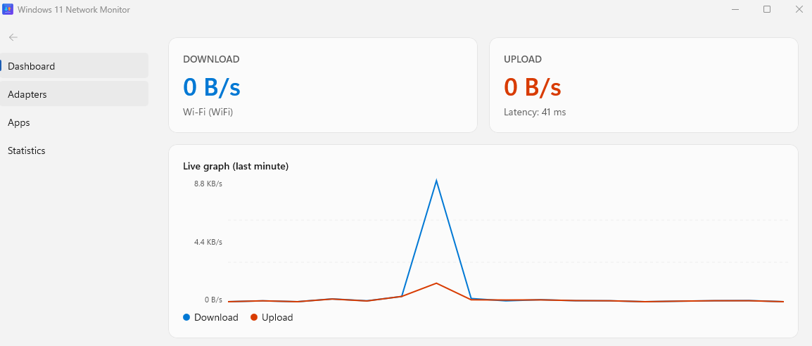
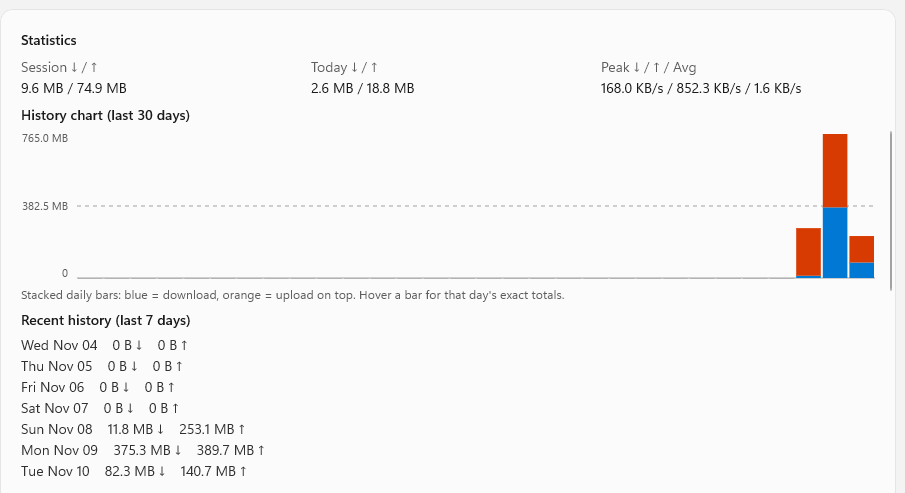
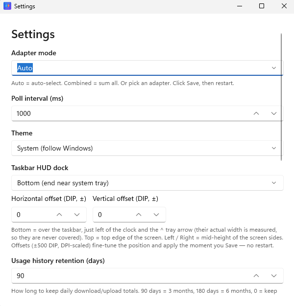
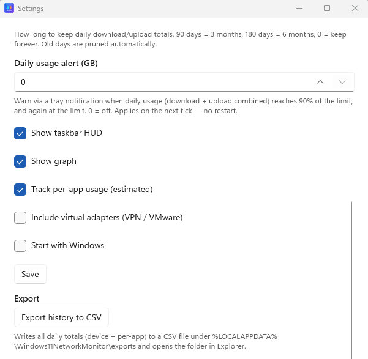
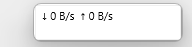

<p align="center">
  
</p>

<h1 align="center">Windows 11 Network Monitor</h1>

<p align="center"><b>Windows 11 Network Monitor</b> — a lightweight, modern network speed monitor for Windows 11 and Windows 10 (1809+). Shows live download/upload speed + graph on the taskbar (HUD) and in the system tray. Auto-detects WiFi, Ethernet, USB tethering, mobile hotspot and any other connection, with per-app usage and per-day history.</p>

<p align="center">
  <a href="https://github.com/NaveenKumarYeluri/windows-11-network-monitor/actions/workflows/build.yml"></a>
  <a href="https://github.com/NaveenKumarYeluri/windows-11-network-monitor/releases/latest"></a>
  <a href="https://github.com/NaveenKumarYeluri/windows-11-network-monitor/releases"></a>
  <a href="LICENSE"></a>
  <a href="https://www.microsoft.com/windows"></a>
</p>

## Why

Windows 11 removed Deskband taskbar extensions, so there's no official way to inject a real control into the taskbar. This project mimics a native extension using the two supported tricks:

1. **System tray icon with live-drawn speed text** — the official, stable way.
2. **Transparent floating HUD docked over the taskbar** — looks like a native applet, follows taskbar position / DPI / resolution.

## Features

- [x] Live download / upload speed (auto `B/s → KB/s → MB/s → GB/s`) for **WiFi, Ethernet, USB tethering, mobile hotspot — any adapter**
- [x] Auto-selects the adapter that owns the default route (internet); **Combined** mode sums all
- [x] **Live graph (last 60 s)** — blue = download, orange = upload, left axis `KB/MB/s` scale + gridlines
- [x] **Statistics** — session ↓/↑, today ↓/↑, peak ↓/↑, average, ICMP latency
- [x] **Recent history (last 7 days)** — daily ↓/↑ totals in Statistics (scrolls with the page, no inner list)
- [x] **Per-app usage (estimated, toggleable)** — *Apps using network now* (live TCP + UDP owner processes, IPv4 + IPv6) + *Top app today* attributed by open-connection share
- [x] **Usage history retention** — Settings slider `0–365 days` (90 = 3 months, 180 = 6 months, 0 = forever) prunes `%LOCALAPPDATA%\Windows11NetworkMonitor\usage-history.json`
- [x] **30-day history chart** — stacked daily bars (blue = download, orange = upload on top) with a bytes Y-axis and hover tooltips showing each day's exact totals; repaints only when a day's totals change or the window reflows. The 7-day text list stays below it
- [x] **WiFi status** — current **SSID · signal %** in the dashboard (via `wlanapi.dll` CURRENT_CONNECTION), refreshed with the same 3 s cadence as latency; hidden on wired-only setups
- [x] **System tray icon** with speed text (updates ~1 Hz; Win11 needs `^` promotion to pin it) — **always on** (it's the app's exit path and restore anchor, so it can no longer be turned off). Left-click opens the dashboard, **right-click opens a native menu** (Open dashboard / ⏸ Pause tracking / Settings / Exit); the icon survives Explorer restarts and **self-heals** if the shell drops it (failed icon updates are re-registered automatically)
- [x] **Pause tracking** — tray menu ⏸ stops accumulating session/daily/history/per-app counters without hiding the link state; live speed, graph and HUD keep updating (HUD shows `⏸`). Persists across restarts
- [x] **Check for updates** — one quiet request to the GitHub Releases API on launch (5 s after startup, nothing sent but a User-Agent header, silent when up to date/offline); tray balloon with the new version tag when a release is out. **Check for updates** in the tray menu reports either way; clicking the balloon opens the release page
- [x] **Daily usage alerts** — set a daily cap in Settings (`0` = off); tray balloon warns at 90% and again when the cap (download + upload combined) is crossed. Alert state persists per day, so restarts don't re-nag; clicking the alert balloon opens the dashboard
- [x] **Taskbar HUD** — borderless, always-on-top `150×28`; **Bottom** (default) docks over the taskbar clear of the clock and `^` tray arrow (tray width measured, not hardcoded), **Top/Left/Right** dock to screen edges; DPI-scaled ±500 DIP offsets in Settings, applied live on Save
- [x] **Single instance** — launching the exe again focuses the running window instead of double-counting usage
- [x] **Runs in the tray (background)** — closing the window **always** keeps the app monitoring in the background (one-time balloon the first time); restore works from the tray icon, the HUD, or a second launch (second-launch restore posts a message to the running instance — `FindWindow` cannot see WinUI windows). To really exit: tray right-click → *Exit*
- [x] **CSV export** — Settings → *Export history to CSV* writes every stored day (device + per-app, bytes) to `%LOCALAPPDATA%\Windows11NetworkMonitor\exports\` and opens the folder
- [x] **Theme** — System / Light / Dark (Main + HUD follow it; Settings stays Light for readability)
- [x] Settings window (JSON in `%LOCALAPPDATA%\Windows11NetworkMonitor\settings.json`), start-with-Windows (`Run` key), adapter / poll-interval controls
- [x] **Icon** — `NetworkMonitor.ico` + PNG/SVG (see Icon section)
- [x] Lightweight: polling every 250–5000 ms (default 1000 ms), no admin needed

> **Limitations to know:** per-app bytes are an **estimate proportional to open-connection count** (Windows exposes no per-socket byte counters to user mode). Byte-accurate counts need a WFP callout driver (admin) — not bundled.

## Screenshots

| | |
|---|---|
|  |  |
| **Dashboard** — live graph + adapters | **Statistics** — 30-day history chart + 7-day list |

| | |
|---|---|
|  |  |
| **Settings** — adapter, theme, HUD dock | **Settings** — alerts, toggles, CSV export |


**Taskbar HUD** — `↓/↑` speeds docked over the taskbar, clear of the tray

*(Screenshots reviewed — no personal data in frame.)*

## Requirements

- Windows 10 1809+ / Windows 11 (build 19041+)
- [NET 8 SDK](https://dotnet.microsoft.com/download) (for building from source)
- No admin rights required

## Install

The app is a **portable folder build — there is no installer and no admin needed**. The folder *is* the app: all files must stay together, but it runs from anywhere.

### Option A — Download and run (recommended)

1. Go to [Releases](../../releases/latest) and download `windows-11-network-monitor-<version>-win-x64.zip` from the newest release (e.g. `...-v1.1.0-win-x64.zip`).
2. Extract the **entire folder** (not just the exe) to a permanent location — this folder is effectively the install:
   - e.g. `C:\Tools\Windows11NetworkMonitor` (create it first), or
   - `%LOCALAPPDATA%\Programs\Windows11NetworkMonitor` (invisible to other users, also needs no admin).
   - Pick a folder that won't move or be cleaned up later (not inside a synced/temp folder).
3. In that folder, double-click **`Windows11NetworkMonitor.exe`**.
4. Windows SmartScreen will warn on first run because the app is unsigned (a code-signing certificate is future work): click **More info → Run anyway**. This only happens once.
5. The app starts: a tray icon (under `^` until you pin it) and a taskbar HUD appear, and counting begins. Settings/data are stored **separately** in `%LOCALAPPDATA%\Windows11NetworkMonitor\` — not inside the folder — so the folder can move later without losing history.
6. **Start with Windows**: open Settings (tray right-click → *Settings*) → toggle **Start with Windows** → Save. Optionally create a Desktop shortcut: right-click the `.exe` → *Send to → Desktop (create shortcut)*. Pin the tray icon for one-click visibility via *Settings → Personalization → Taskbar → Other system tray icons* (Win11 hides new icons under `^` by default).
7. **Updating to a newer version**: quit the app (tray right-click → *Exit*), download the new zip, and overwrite the folder's contents (keep the same folder). History and settings survive — they live in the data folder above. The app also checks for updates itself and shows a tray balloon when a release is out.
8. **Uninstalling**: quit the app, delete the app folder, and delete `%LOCALAPPDATA%\Windows11NetworkMonitor\` to erase all history/settings.

### Option B — Build from source
```powershell
git clone https://github.com/NaveenKumarYeluri/windows-11-network-monitor.git
cd windows-11-network-monitor
dotnet build Windows11NetworkMonitor.sln -c Release
```
CI builds are also available as artifacts on every push (see Actions tab). Signed/packaged MSIX releases are future work (see Roadmap) — today the app ships as this zipped folder build.

## Usage

1. Launch the app — tray icon + taskbar HUD appear (the tray icon is always on; it's the app's exit path). Launching it again brings the running instance back (single-instance). **Closing the window always keeps the app running in the tray** (a one-time balloon confirms it); click the tray icon, tap the HUD, or launch the exe again to bring the dashboard back. To really exit: tray right-click → *Exit*. If the icon sits under `^`, pin it via *Settings → Personalization → Taskbar → Other system tray icons*.
2. Left-click the tray icon (or tap the HUD) to open the dashboard; **right-click the tray icon** for the menu: *Open dashboard*, *⏸ Pause/Resume tracking*, *Check for updates*, *Settings*, *Exit*.
3. **Settings** (tray menu, or the button in `NavigationView.Header`): adapter mode (applies immediately), poll interval (restart to apply), Theme (System/Light/Dark), history retention (0–365 days), daily usage alert (GB), HUD dock side + offsets, HUD/graph toggles, *Track per-app usage*, virtual adapters, *Start with Windows*, CSV export.
4. **Pause tracking** (tray menu ⏸): session/daily/history/per-app counters stop accumulating; live speed, graph and HUD keep updating (HUD shows `⏸`). The paused state is saved, so it survives restarts.
5. **Updates**: the app checks GitHub Releases once on launch (a single unauthenticated ping, no telemetry) and shows a tray balloon when a newer version exists; *Check for updates* in the tray menu re-checks on demand and reports the result. Clicking the update balloon opens the release page.
6. **Daily usage alert**: Settings → *Daily usage alert (GB)* — set e.g. `4`; you get a tray balloon at 90% of the cap and again at the cap (download + upload combined). `0` disables it. Alert stage is saved per day, so it fires once per threshold no matter how often you restart.
7. Data files: `%LOCALAPPDATA%\Windows11NetworkMonitor\settings.json` and `usage-history.json`. Delete that folder to reset. Daily/session counters and history are saved on every exit **and flushed ~once a minute while running**, so even a hard kill (crash, reboot, force-close) loses at most about a minute of counts.

### Auto-detect logic

```
Enumerate adapters where:
  OperStatus == Up AND NOT Loopback AND (optionally include Virtual)
Poll InOctets / OutOctets every interval (default 1000 ms, editable 250–5000 ms)
speed = (current - previous) / interval
Active = adapter with IPv4 (fallback IPv6) that owns the default route; else first Up
Combined = sum of all Up non-loopback adapters
Switches automatically when WiFi drops and Ethernet comes up
```

### Per-app tracking (estimated)

```
GetExtendedTcpTable + GetExtendedUdpTable (AF_INET + AF_INET6, owner-PID tables) → PID → ProcessName (cached 10 s)
Each tick: device ↓/↑ delta × (app connections / Σ connections) → per-app daily total
Stored per-app per-day alongside device totals; pruned by the same retention setting
```


## Architecture

```
NetworkAdapterService (NetworkInterface) → SpeedHistory (~60 s window, derived from poll interval)
    → MainWindow graph/stats + TrayIconService + HudWindow
    → HistoryStore (usage-history.json, device + per-app, retention 0–365 d)
    → PerAppTracker (GetExtendedTcpTable + GetExtendedUdpTable, share-by-connection estimate)
SettingsService (JSON) ← SettingsWindow (WinUI Fluent)
WifiService (Ping latency + WiFi SSID/signal via wlanapi)
UpdateChecker (GitHub Releases API → tray balloon)
```

For the full picture (data flow, auto-detect logic, per-app attribution math) see [docs/ARCHITECTURE.md](docs/ARCHITECTURE.md).

## Tech Stack

| Layer        | Choice                                      |
| ------------ | ------------------------------------------- |
| Language     | C# .NET 8                                   |
| UI           | WinUI 3 (Windows App SDK 1.7.250310001)      |
| Network      | `System.Net.NetworkInformation` + Win32 `iphlpapi` / `shell32` |
| Graph        | Custom Canvas/Polyline (v1, zero deps) — LiveChartsCore planned |
| Build        | GitHub Actions (`windows-2022`, MSBuild)      |
| Packaging    | Unpackaged self-contained **folder** WinExe (single-file WinUI crashes with `0x80040111`), MSIX planned |

## Roadmap

See [docs/ROADMAP.md](docs/ROADMAP.md) — LiveCharts upgrade, MSIX/installer, auto-update download link, localization.

## Contributing

See [CONTRIBUTING.md](CONTRIBUTING.md). PRs welcome — focus on:

1. HUD taskbar positioning edge cases (multi-monitor, vertical taskbar, auto-hide)
2. LiveChartsCore graph upgrade
3. MSIX / Store packaging + signing
4. Localization

## License

MIT — see [LICENSE](LICENSE). Copyright © 2026 Naveen Kumar Yeluri.

## Icon

`src/Windows11NetworkMonitor/Assets/NetworkMonitor.ico` (multi-size) + `NetworkMonitor-*.png` + editable `NetworkMonitor.svg`. The icon shows live up/down arrows with a pulse line on a blue→violet rounded square — download (cyan) and upload (orange) to match the graph colors. Generated with Pillow (supersampled antialiasing) from the SVG source.

## Built with AI assistance

This project was built with **AI assistance (Claude / OpenCode)** — the assistant generated scaffolds, WinUI XAML/C# implementation, CI workflows and icon assets, then iterated with the maintainer through testing (tray/HUD behavior, scroll bugs, per-app attribution). Every change was reviewed, tested and committed by the maintainer, who owns all product decisions and release choices. No third-party code was copied; dependencies are NuGet packages under their own licenses (below).

Suggested citation: *Naveen Kumar Yeluri (2026), Windows 11 Network Monitor, MIT.*

## Acknowledgments

**Original work:** all application code in `src/` was written for this project — see git history. No code was copied from existing monitors.

**Inspiration (concepts only, no code reused):** TrafficMonitor, GlassWire, XMeters.

**Dependencies (NuGet, used as binaries — not copied into source):**
- `.NET 8` (runtime/SDK) — MIT
- `Microsoft.WindowsAppSDK 1.7.250310001` (WinUI 3) — MIT
- `CommunityToolkit.Mvvm 8.2.2` (`ObservableObject`) — MIT
- `System.Drawing.Common 8.0.0` (tray icon drawing) — MIT

**System APIs used (no code copied):** `System.Net.NetworkInformation`, Win32 `iphlpapi.dll` (`GetExtendedTcpTable`/`GetExtendedUdpTable` for per-process connection enumeration), `shell32.dll` (`Shell_NotifyIcon`), `user32.dll` (`SetWindowSubclass`/`DefSubclassProc` for tray message routing, `GetDpiForWindow`), `wlanapi.dll` (`WlanQueryInterface` CURRENT_CONNECTION for SSID + signal %), `comctl32.dll`.

Per-app byte counts are **estimates proportional to open-connection count** — the shipped build does not bundle a WFP driver. Windows byte-accurate attribution would require an admin ETW/WFP callout (future work).
